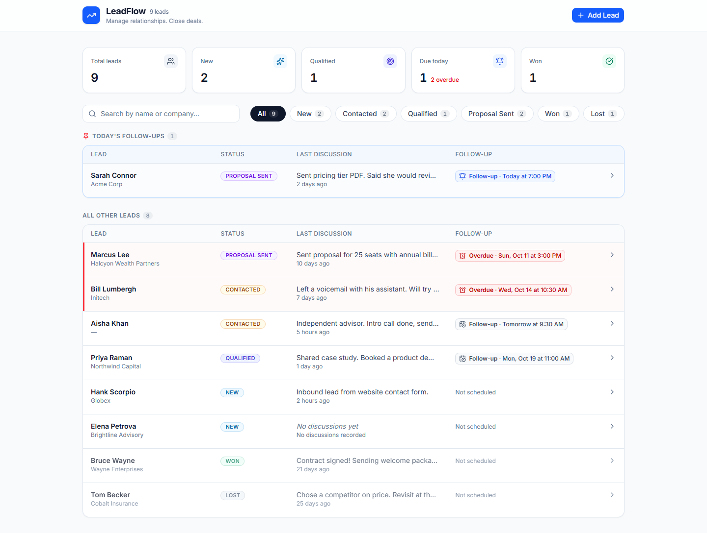
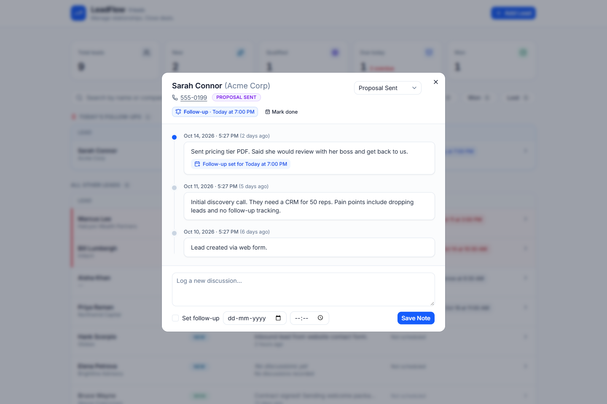
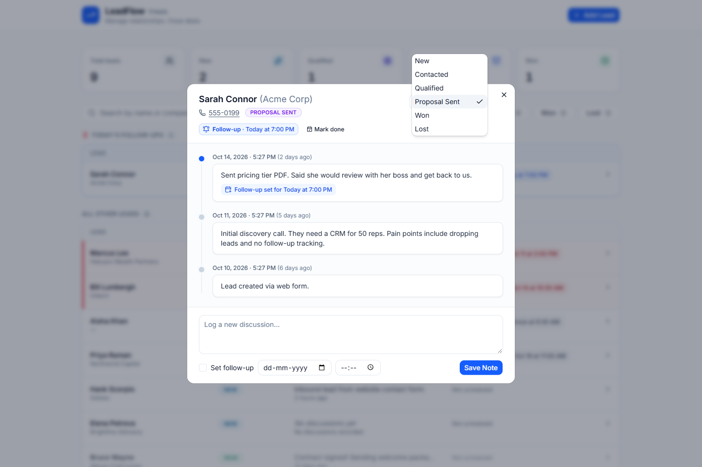
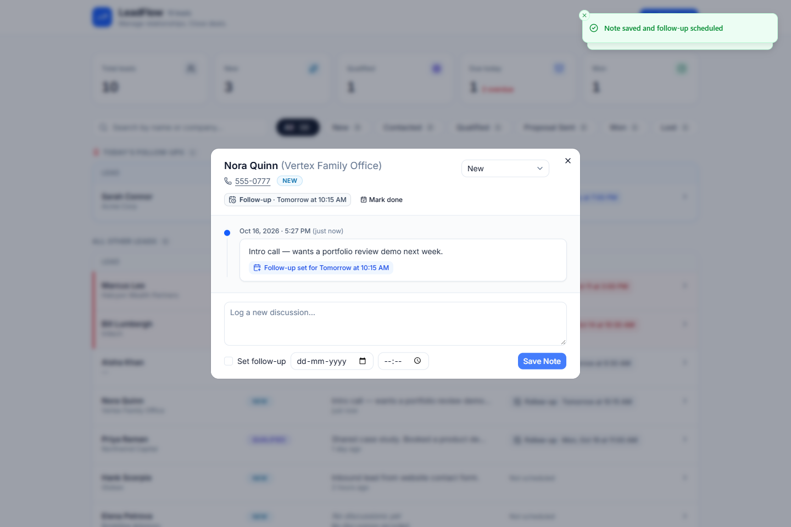
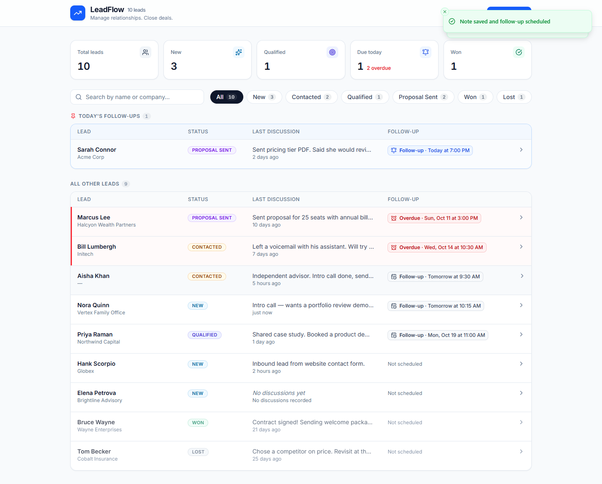
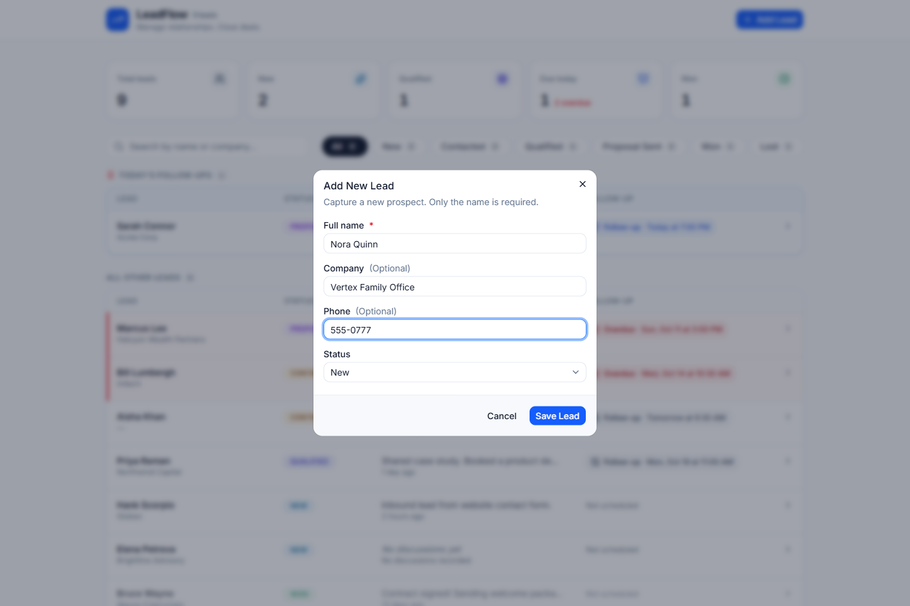
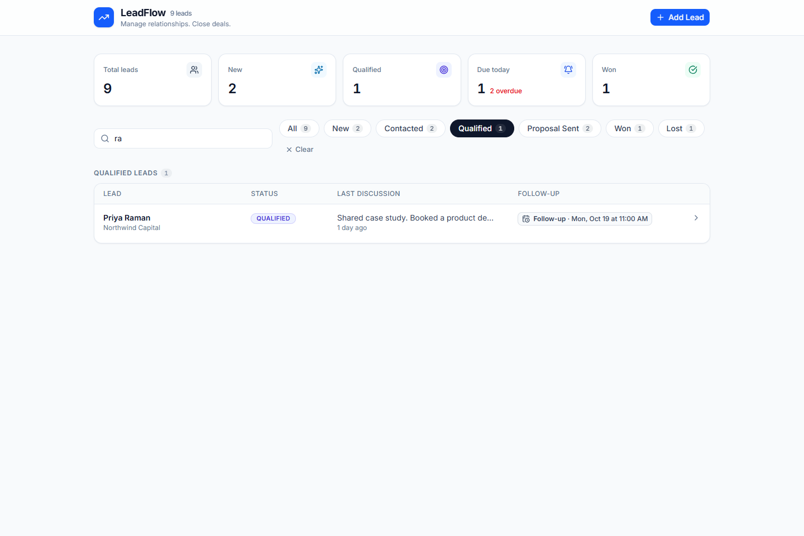
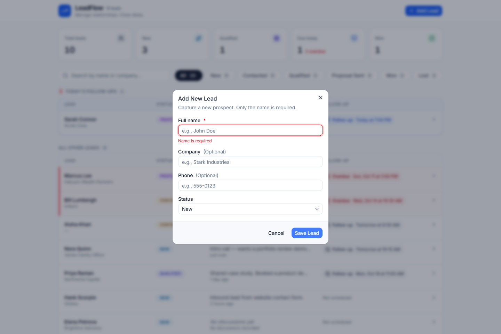

# LeadFlow

A lightweight CRM for sales reps: track leads through the pipeline, log every conversation, and never miss a follow-up. Everything happens on a single dashboard. Opening a lead shows its timeline in a dialog, without leaving the page.

## Features

- **Dashboard metrics** computed from live data: total leads, new, qualified, follow-ups due today (plus an overdue count), and won.
- **Lead list** showing each lead's name, company, status badge, latest note, time since the last discussion (e.g. "2 hours ago"), and next follow-up.
  - Leads with a follow-up **today** are pinned in a separate section at the top.
  - **Overdue** follow-ups, including ones earlier today, are highlighted in red.
  - Sort order: today's follow-ups, then overdue (oldest first), then upcoming (soonest first), then leads with no follow-up (most recent activity first).
- **Search** by name or company (case-insensitive, partial match, debounced) and **filter** by any of the six statuses, with a clear-filters control. Each filter chip shows its count.
- **Lead timeline dialog**:
  - Contact details and current status, which you can change from a dropdown.
  - The current follow-up, with a "Mark done" button.
  - Full discussion history, newest first, including the follow-up set on each discussion.
  - A form to log a new discussion, with an optional follow-up date and time.
- **Add Lead dialog**: name (required), company, phone, and status (defaults to New), with inline validation and duplicate-phone detection.
- **Immediate UI updates** after every change, with toast notifications. Buttons are disabled while a request is in flight, so you can't submit twice.
- **Responsive and accessible**: a table on desktop and compact cards on mobile. Rows and controls are keyboard-operable, focus is visible, and dialogs are accessible (Radix). Includes loading, empty, and error states.

## Screenshots

| Dashboard: today's follow-ups pinned, overdue in red | Lead timeline dialog |
| --- | --- |
|  |  |
| **Status update from the dialog** | **Add a discussion with a follow-up** |
|  |  |
| **List updates immediately** | **Add lead** |
|  |  |
| **Search + status filter** | **Validation** |
|  |  |

The mobile layout is in [docs/screenshots/09-mobile.png](docs/screenshots/09-mobile.png).

## Tech stack

| Concern | Choice |
| --- | --- |
| Framework | Next.js 16 (App Router, Route Handlers), React 19, TypeScript |
| Styling / UI | Tailwind CSS v4, shadcn/ui (Radix), Lucide icons, Sonner toasts |
| Database | **Supabase** (managed PostgreSQL 17) via Prisma ORM 7 (`@prisma/adapter-pg`); local Docker Postgres for tests |
| Validation | Zod 4, with the same schemas on client and server |
| Dates | date-fns |
| Tests | Vitest (unit tests and API tests against a real Postgres test database) |
| Ops | Docker Compose, multi-stage Dockerfile (Next.js standalone output) |

## Architecture

```
prisma/
  schema.prisma          Lead + Discussion models, LeadStatus enum, indexes
  migrations/            Committed SQL migrations
  seed.ts                Idempotent seed (9 leads, relative dates)
src/
  app/
    page.tsx             Dashboard entry (renders the client dashboard)
    api/
      leads/route.ts                    GET (list/filter/search), POST
      leads/[id]/route.ts               GET (detail + history), PATCH
      leads/[id]/discussions/route.ts   GET, POST
      stats/route.ts                    GET dashboard metrics
  components/
    leads/               Dashboard, lead list, dialogs, badges
    ui/                  shadcn/ui primitives
  hooks/                 useNow (hydration-safe clock), useDebouncedValue
  lib/
    leads/               Shared and client-safe code: statuses, types, Zod schemas, follow-up logic
    server/              Server-only code: Prisma client, lead service, error handling
    api-client.ts        Typed fetch wrapper used by the UI
tests/
  unit/                  Follow-up classification, sorting, formatting, validation
  api/                   Route handlers exercised against Postgres
```

The code is organized in layers:

- **Route handlers** are thin: they parse and validate input, then call the service.
- **`lib/server/leads-service.ts`** holds all database logic.
- **`lib/leads/*`** holds pure domain logic shared by the UI and the server.
- **Errors** are mapped to one consistent JSON shape in `lib/server/errors.ts`.

## Prerequisites

- Node.js **20.19+** (developed on Node 22)
- npm 10+
- A **Supabase** project (the free tier is enough), or any PostgreSQL 14+ server
- Docker with Docker Compose v2, used for the local test database and the optional container build

## Environment variables

Copy the example file and adjust the placeholders:

```bash
cp .env.example .env        # Windows (cmd): copy .env.example .env
```

| Variable | Required | Purpose |
| --- | --- | --- |
| `DATABASE_URL` | Yes | Database the **app** uses at runtime. On Supabase: the transaction-mode pooler (port `6543`) with `?pgbouncer=true`. |
| `DIRECT_URL` | Yes for Supabase | Database the **Prisma CLI** uses for migrations and seeding. On Supabase: the session-mode pooler (port `5432`). If unset, Prisma falls back to `DATABASE_URL`. |
| `TEST_DATABASE_URL` | For tests | A disposable **local** database for the test suite. Tests delete every row, so they refuse to run against a remote database. |
| `POSTGRES_USER`, `POSTGRES_PASSWORD`, `POSTGRES_DB`, `POSTGRES_PORT` | For tests | Credentials and port for the local Compose `db` service. They must match `TEST_DATABASE_URL`. |
| `APP_PORT` | No | Host port for the containerized app (default `3000`) |

**Getting the Supabase URLs:** open your project, click **Connect → ORMs → Prisma**, and copy both connection strings. Replace `[YOUR-PASSWORD]` with your database password (reset it under **Project Settings → Database** if you don't have it). Use the exact pooler host shown there: it may be `aws-0-…` or `aws-1-…`, depending on the project.

`.env` is git-ignored. No secrets are committed.

## Local development

```bash
cp .env.example .env              # 1. fill in the Supabase URLs (see above)
npm install                       # 2. install deps (postinstall runs `prisma generate`)
npm run db:deploy                 # 3. apply migrations to Supabase
npm run db:seed                   # 4. load sample data (safe to rerun)
npm run dev                       # 5. http://localhost:3000
```

**Without Supabase:** run `docker compose up -d db`, then point both `DATABASE_URL` and `DIRECT_URL` at `postgresql://leadflow:<password>@localhost:5432/leadflow?schema=public`. The steps above work unchanged.

### Database commands

| Command | What it does |
| --- | --- |
| `npm run db:deploy` | Apply committed migrations (`prisma migrate deploy`) |
| `npm run db:migrate` | Create and apply a new migration after editing the schema (`prisma migrate dev`) |
| `npm run db:seed` | Upsert the seed leads and replace their discussions. Rerunning does not create duplicates. |
| `npm run db:reset` | Drop all data, re-apply migrations, and reseed |
| `npm run db:generate` | Regenerate the Prisma client into `src/generated/prisma` |

The seed uses dates relative to the current time. Every run therefore includes a follow-up due later today, two overdue follow-ups, upcoming follow-ups, a lead with no discussions, and leads with several discussions, across all six statuses.

### Production build

```bash
npm run build
npm start                         # serves on http://localhost:3000
```

## Testing and quality checks

```bash
docker compose up -d db   # local Postgres for the test database
npm test             # Vitest: unit + API tests
npm run lint         # ESLint (next/core-web-vitals + TypeScript)
npm run typecheck    # next typegen + tsc --noEmit
npm run build        # production build
```

The API tests call the route handlers directly against `TEST_DATABASE_URL`, a local Postgres database. The test setup creates it if it doesn't exist and applies migrations. Tests **never** touch Supabase: if `TEST_DATABASE_URL` is unset and `DATABASE_URL` is remote, the suite refuses to run.

What the tests cover:

- Lead creation and validation, invalid-status rejection, malformed JSON, and duplicate-phone 409.
- Missing lead returns 404; a malformed id returns 400.
- Discussion creation and newest-first ordering.
- Follow-up scheduling that updates the lead in the same transaction, follow-up replacement, and not clearing an existing follow-up when none is supplied.
- Status updates that persist and keep the discussion history.
- Stats for the client's local day.
- Classification of today, overdue, and upcoming follow-ups, plus the dashboard sort order. Run under several timezones.

## Docker Compose

The containerized app connects to Supabase using `DATABASE_URL` and `DIRECT_URL` from `.env`. The `migrate` job and the `app` service run under the `app` profile. The local `db` service is only for tests and offline work.

```bash
docker compose --profile app up -d --build                  # migrate → app
docker compose --profile app run --rm migrate npx prisma db seed   # optional sample data
# open http://localhost:3000

docker compose --profile app logs -f app                    # follow logs
docker compose --profile app down                           # stop the app

docker compose up -d db                                     # local Postgres for tests
docker compose down -v                                      # stop it and delete its data
```

- `migrate` runs `prisma migrate deploy` and exits.
- `app` starts only after migrations have succeeded, and has its own HTTP health check.
- The local `db` service has a `pg_isready` health check and keeps its data in the `pgdata` volume.

## API

All responses are JSON. Successful responses wrap their payload in `data`. Errors use one shape:

```json
{ "error": { "code": "VALIDATION_ERROR", "message": "Name is required", "fieldErrors": { "name": ["Name is required"] } } }
```

| Status | Code | When |
| --- | --- | --- |
| 400 | `VALIDATION_ERROR` | Body or query fails Zod validation |
| 400 | `INVALID_JSON` | Body is not valid JSON |
| 400 | `INVALID_ID` | `:id` is not a UUID |
| 404 | `NOT_FOUND` | Lead does not exist |
| 409 | `CONFLICT` | Another lead already has this phone number |
| 500 | `INTERNAL_ERROR` | Unexpected error. Details are logged server-side and never returned. |

Timestamps are ISO-8601 strings in UTC. `status` is one of `NEW`, `CONTACTED`, `QUALIFIED`, `PROPOSAL_SENT`, `WON`, `LOST`.

### `GET /api/leads`

Lists leads with their latest discussion. Optional query parameters:

- `status`: one of the statuses above.
- `q`: case-insensitive partial match on name or company.

```bash
curl "http://localhost:3000/api/leads?status=PROPOSAL_SENT&q=acme"
```

```json
{
  "data": [{
    "id": "5e3d1a10-0000-4000-8000-000000000001",
    "name": "Sarah Connor", "company": "Acme Corp", "phone": "555-0199",
    "status": "PROPOSAL_SENT",
    "nextFollowUpAt": "2026-10-15T16:30:00.000Z",
    "lastDiscussion": { "note": "Sent pricing tier PDF…", "createdAt": "2026-10-13T15:05:39.674Z" },
    "discussionCount": 3,
    "createdAt": "2026-10-09T15:05:39.674Z",
    "updatedAt": "2026-10-15T15:05:40.199Z"
  }]
}
```

The server orders leads by `nextFollowUpAt` (nulls last), then by most recent discussion. The client then groups them into today, overdue, upcoming, and none, using the viewer's local calendar day.

### `POST /api/leads` → `201`

```bash
curl -X POST http://localhost:3000/api/leads \
  -H "Content-Type: application/json" \
  -d '{"name":"Ada Lovelace","company":"Analytical Engines","phone":"555-0101","status":"NEW"}'
```

`name` is required (1–120 characters). `company`, `phone`, and `status` are optional, and `status` defaults to `NEW`. Unknown fields are rejected.

### `GET /api/leads/:id`

Returns the lead and `discussions` (newest first): `[{ id, note, followUpAt, createdAt }]`. Responds 404 if the lead doesn't exist.

### `PATCH /api/leads/:id`

Updates any of `name`, `company`, `phone`, `status`, or `nextFollowUpAt`. At least one field is required. Setting `nextFollowUpAt` to `null` clears the current follow-up ("Mark done").

```bash
curl -X PATCH http://localhost:3000/api/leads/<id> \
  -H "Content-Type: application/json" -d '{"status":"QUALIFIED"}'
```

### `GET /api/leads/:id/discussions`

Returns the discussion history, newest first.

### `POST /api/leads/:id/discussions` → `201`

```bash
curl -X POST http://localhost:3000/api/leads/<id>/discussions \
  -H "Content-Type: application/json" \
  -d '{"note":"Demo booked with the COO","followUpAt":"2026-10-20T05:30:00.000Z"}'
```

- `note` is required (up to 5,000 characters).
- `followUpAt` is optional. It must be an ISO-8601 datetime with an offset, and not in the past (5 minutes of tolerance for clock skew).
- The discussion insert and the lead update (`nextFollowUpAt`, last-activity time) run in one transaction.

### `GET /api/stats?dayStart=<ISO>&dayEnd=<ISO>`

Returns `{ total, byStatus, dueToday, overdue }`. The client sends the bounds of its own local day, so "due today" follows the viewer's timezone.

## Design decisions and assumptions

- **Follow-up model.** `Lead.nextFollowUpAt` is the single current follow-up. A new discussion that includes a follow-up **replaces** it. A discussion without one **leaves it unchanged**. Every follow-up ever set is kept on its `Discussion.followUpAt`, so the history stays visible in the timeline. You can clear the current follow-up with "Mark done" (`PATCH nextFollowUpAt: null`).
- **Today, overdue, and upcoming.** Timestamps are stored as UTC (`timestamptz`) and classified in the **browser's timezone**:
  - *Today*: any time on the viewer's current calendar day. These leads are pinned. If the time has already passed, the lead is also shown as past due in red.
  - *Overdue*: before today.
  - *Upcoming*: after today.

  The clock refreshes every 30 seconds, so labels stay current without a reload.
- **Pinned section and filters.** Today's follow-ups are pinned *within* the current search and filter results. For example, with "Proposal Sent" selected, only today's proposal-stage follow-ups are pinned.
- **Date-only follow-ups** default to 9:00 AM local time. Follow-ups must be in the future.
- **Duplicate handling.**
  - The client disables submit buttons while a request is in flight.
  - The server returns **409** when a new or updated phone number matches an existing lead, comparing digits only so `555-0199` matches `(555) 0199`.
  - Names are deliberately not unique.
- **Invalid UUIDs** return 400 (`INVALID_ID`) instead of 404, so the client can tell a malformed request apart from a missing lead.
- **`Lead.lastDiscussionAt`** is a denormalized timestamp. It is updated in the same transaction as the discussion insert, so the list can sort by recent activity without aggregating.
- **No N+1 queries.** The list loads each lead's latest discussion and discussion count through a single Prisma `select`, which Prisma batches.
- **Data fetching** is client-side against the REST API: the page is a static shell, and the dashboard fetches and refetches after each change. Responses for superseded requests are aborted, so a fast typist never sees stale results.
- **Supabase connections.** The app uses the transaction-mode pooler, which suits many short-lived connections. Prisma migrations use the session-mode pooler, because they need a session-level connection. Supabase's direct host is IPv6-only, which many networks can't reach.
- **Row Level Security** is enabled on every table (a migration does this). Supabase exposes the `public` schema through its REST API with a public anon key, and RLS with no policies blocks that path entirely. The app connects through Prisma as the table owner, so RLS doesn't affect it.
- **FastAI is not used.** The required CRM features don't need ML, so no artificial AI features were added.

## AI usage

This project was built with an AI coding assistant (Claude Code), as the brief encourages. The assistant wrote most of the code, tests, Docker setup and this README, following a detailed specification I provided. I reviewed the work and verified it by running:

- the automated test suite (`npm test`), lint, type checking and the production build;
- scripted browser runs of every flow (search, each status filter, add lead, duplicate phone, add discussion with follow-up, status change, persistence after reload, mobile layout) against both the production build and the Docker image.

Problems caught during that verification and fixed are visible in the commit history. One example: an API error wrapper that swallowed Next.js's internal prerender signal.

## Known limitations

- No authentication or multi-user ownership; this is a single-team workspace.
- No pagination. The list returns every matching lead, which is fine for hundreds of leads but not tens of thousands.
- Leads can't be deleted, and the UI doesn't edit name, company, or phone (the PATCH API supports these fields).
- The duplicate-phone check runs in the application, not as a database constraint. Two simultaneous creates with the same number could both succeed.
- No real-time sync between browsers. Other users' changes appear on the next refresh or mutation.
- Closed leads (Won or Lost) keep any scheduled follow-up until it is marked done.
